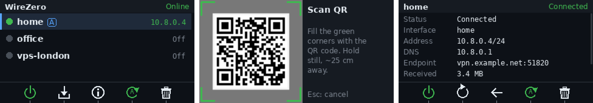

# WireZero

**A WireGuard VPN client for the M5Stack CardputerZero.**

Import a tunnel from a `.conf` file or by scanning its QR code with the camera, then connect from the keyboard. The app never runs as root and your private keys stay readable by root only.



## How it works

1. **Import.** Press `5` to pick a `.conf` from your home folder, a USB stick or the SD card's boot partition, or `6` there to scan a QR code.
2. **Connect.** Press `Enter` on a tunnel. The dot turns green and shows your tunnel address.
3. **Check.** Press `6` for address, DNS, endpoint and traffic. Press `7` to connect at boot.

Tunnels are stored by NetworkManager, so they keep working after you close the app.

## Install

Search the CardputerZero Store for **WireZero** (share code `WGZ0`), or build the `.deb` with `packaging/build-deb.sh` and run:

```sh
sudo apt install ./wirezero_0.4.1-1_arm64.deb
```

Needs the official CardputerZero image (Debian 13 with NetworkManager). QR scanning needs the camera, so the Lite model is file import only.

## Keys

| Key | Action |
|---|---|
| `Enter` / `4` | Connect or disconnect |
| `5` | Import (`6` there scans a QR code) |
| `6` / `C` | Tunnel details |
| `7` | Auto-connect at boot |
| `8` | Delete tunnel |
| `F` / `X` | Up / down |
| `H` | Help |
| `Esc` | Back / quit |

## Security

- Installs no sudo or polkit rules. When the system needs admin rights (adding, deleting, auto-connect), WireZero asks for your password and runs a small helper that only acts on WireGuard profiles and never returns key material. The password is kept in memory for 5 minutes and never saved.
- Keys never touch disk outside NetworkManager's root-only store. After a file import, WireZero offers to delete the original `.conf`.
- `PostUp`/`PreUp` scripts are stripped, and configs that change system routing (`FwMark`, a custom `Table`) are refused.
- Screenshots are blocked on the camera and password screens.

## Limitations

- "Connected" means the tunnel is up, not that the server answered.
- No kill switch: if the tunnel drops, traffic falls back to your normal connection.
- A QR code only works if it includes the device's private key. Some servers only show that when the keys are first generated.

## Development

```sh
python3 -m unittest discover -s tests   # tests
python3 -m wirezero --sim screenshots   # render every screen with fake tunnels
packaging/build-deb.sh                  # build the .deb
```

## Contributing

Issues and PRs welcome.

## License

MIT. WireGuard is a registered trademark of Jason A. Donenfeld; WireZero isn't affiliated with the WireGuard project.
