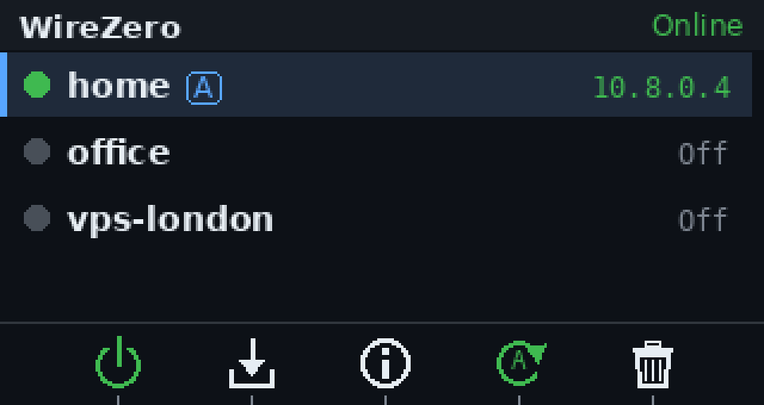

# WireZero

WireGuard VPN tunnels for the [M5Stack CardputerZero](https://docs.m5stack.com/en/CardputerZero).
Import a `.conf`, press Enter, you're on your VPN. Pair it with an SSH app
(e.g. Zero SSH from the store) to reach machines behind it.



## Features

- Import standard WireGuard (`wg-quick`) `.conf` files
- Or scan your router's WireGuard QR code with the camera (standard model)
- Connect / disconnect with one key, live status in the list
- Details: address, DNS, endpoint, bytes sent/received
- Auto-connect at boot, per tunnel (off by default for new imports)
- Delete with confirmation
- Never runs as root: NetworkManager does the work

## Keys

| Key | Action |
|---|---|
| Enter / 4 | Connect or disconnect |
| 5 | Import a `.conf` file |
| 6 / C | Tunnel details |
| 7 | Toggle auto-connect at boot |
| 8 | Delete tunnel |
| F / X | Move up / down |
| H or fn+H | Help |
| fn+J | Screenshot to `~/Pictures/Screenshots/` |
| Esc | Back / quit |

## Getting a config onto the device

**Easiest: scan the QR code.** Press 5 (Import), then 6 (camera), point it at
the WireGuard QR code from your VPN server, then type a name and press Enter. The config, including the private
key, only exists in memory until it is handed to NetworkManager. Needs
`python3-picamera2` and `libzbar0t64` (installed automatically) and the
camera of the standard CardputerZero (the Lite has none). The QR code must
contain the client's private key; some servers only include it when the
client's keys are first generated, and WireZero will tell you if it's missing.

**Or copy a file:**

WireZero looks for `*.conf` files in:

- your home folder and `~/wireguard/`, `~/Downloads/`
- the SD card's boot partition (`/boot/firmware/`): handy, as you can copy the
  file there from a PC
- USB sticks under `/media/`

From a PC: `scp mytunnel.conf pi@<cardputer-ip>:~/`

The file name becomes the tunnel name (letters, digits, `-` and `_`, max 15
characters). After importing, WireZero offers to delete the original file,
because it contains your private key. NetworkManager keeps its own
root-only copy.

## Security design

WireZero only manages tunnels. The encryption is done by WireGuard in the
Linux kernel and is never touched by this app. The design goal is that
installing WireZero must not make your private keys easier to steal.

| Part | Runs as | Can do |
|---|---|---|
| The app (`/usr/lib/wirezero`) | your user | list tunnels, connect, disconnect (polkit: `network-control` only) |
| `/usr/libexec/wirezero/wirezero-helper` | root, via one `sudo` rule | import / delete / auto-connect **WireGuard profiles only** |
| NetworkManager | root | stores keys in `/etc/NetworkManager/system-connections` (root-only, 0600) |

- **Keys stay root-only.** The app is not granted `settings.modify.system`,
  because in NetworkManager that permission also allows *reading* stored
  secrets. Imports go through the helper, which takes the config on stdin
  (never in command-line arguments) and never prints secrets.
- **Narrow helper.** Three commands, exact-match argument checks (tunnel names
  `[A-Za-z0-9][A-Za-z0-9_-]{0,14}`, UUIDs only), refuses anything that is not
  a WireGuard profile, never opens files named by the caller, runs
  `python3 -IB` with a fixed `PATH` and absolute `nmcli` path. The helper and
  the code it imports live in root-only system paths; the installer refuses to
  add the sudo rule if any part of those paths is writable by anyone but root.
- **No scripts, no routing tricks.** `PreUp`/`PostUp`/`PreDown`/`PostDown`
  are stripped (NetworkManager ignores them anyway). Configs using `FwMark`,
  a custom routing `Table`, or a privileged `ListenPort` are refused.
- **Safe defaults.** New tunnels have auto-connect switched off before
  anything else and start disconnected. Full-tunnel configs get
  `dns-priority -50` so DNS can't leak to the local network's resolver.
- **Key file hygiene.** Configs are read without following symlinks (max
  64 KB), handed to NetworkManager via a root-only temp dir on `/run` (RAM,
  never disk) as 0600, deleted straight after import, and the app offers to
  remove your original `.conf`. Keys are validated before import and errors
  never show key material.
- **QR codes.** The decoded config only exists in memory. Screenshots (fn+J)
  are blocked on the camera screen, because the preview shows the QR code and
  therefore your key; other screenshots are saved 0600.
- **No code injection.** The launcher and helper run Python in isolated mode,
  so files in the current folder, `PYTHONPATH` or `~/.local` can't replace
  WireZero's code. All commands run without a shell.
- **Clean removal.** Uninstalling removes the sudo rule, polkit rule and the
  `wirezero` group membership.
- **CI.** GitHub Actions are pinned to commit hashes, the test dependency is
  pinned, checkout doesn't keep credentials, and only the tag-only release job
  can write to the repo.

### Trust model and known limits

- Every app on the CardputerZero runs as the same user, so any app could ask
  the helper to add or remove a *WireGuard* tunnel, or connect/disconnect
  NetworkManager profiles. No app can read your keys through WireZero.
- "Connected" means the tunnel is up, not that the server answered. A real
  reachability check is planned.
- No kill switch: if the tunnel drops, traffic falls back to the normal
  network.
- With `AllowedIPs = 0.0.0.0/0` but no `::/0`, IPv6 traffic bypasses the
  tunnel (WireZero warns at import).
- If you add your user to the `wirezero` group by hand, reboot afterwards.

Requirements: the official CardputerZero image (Debian 13 with
NetworkManager), `python3-pil`, `python3-evdev`, `sudo`.

## Develop

```bash
python3 -m unittest discover -s tests       # tests (needs Pillow)
python3 -m wirezero --sim screenshots       # render every screen with fake tunnels
packaging/build-deb.sh                      # -> build/wirezero_<ver>-1_arm64.deb
python3 tools/make_icons.py                 # regenerate icons
```

Install on the device: `sudo apt install ./wirezero_0.3.1-1_arm64.deb`

## License

MIT. WireGuard is a registered trademark of Jason A. Donenfeld. WireZero is
not affiliated with or endorsed by the WireGuard project.
